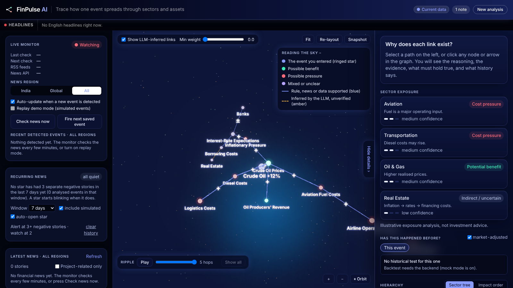

<div align="center">

# MarketRipple (FinPulse AI)

**See how one news headline ripples through sectors, assets and companies.**

[](https://github.com/singhaiyashjain/MarketRipple/actions/workflows/ci.yml)
[](https://singhaiyashjain.github.io/MarketRipple/)

### 👇 Click the picture to open the live project 👇

[](https://singhaiyashjain.github.io/MarketRipple/)

[**Open live project**](https://singhaiyashjain.github.io/MarketRipple/) · [API docs](https://marketripple.onrender.com/docs)

</div>

Paste a headline about a rate decision, a commodity move or a currency shock, and MarketRipple turns it into an interactive 3D "night sky" graph. Each star is a sector, asset or company. Each link has a reason, a source and a historical check behind it.

> The hosted site may take 30-60 seconds to respond on the first request, because the free backend sleeps when idle.

---

## What it does

- **Reads the news.** Extracts the event (type, entity, indicator, direction, change, driver, country, date). Anything not in the text is left empty, never guessed.
- **Traces the spread.** Searches a curated, India-focused graph (61 nodes, 84 edges) for the strongest paths, up to 5 hops.
- **Shows the evidence.** Every link has an explanation, a source or rule, the conditions it depends on, and, where data exists, historical statistics. Links proposed by the AI are clearly marked as unverified.
- **Shows sector exposure.** Which sectors may benefit or come under pressure (illustrative, not investment advice).
- **Watches the news live.** Polls RSS feeds (and optionally NewsAPI), analyses new events and replays the ripple.
- **Flags recurring bad news.** Stars that keep getting negative stories blink as alerts.
- **Checks history.** "The last 5 times this happened": past shocks to the same driver and what moved afterwards.

### Main features

| Area | Features |
|---|---|
| Input | Paste text, sample events, Ctrl+Enter to run, live headline ticker, latest-news panel |
| 3D graph | Orbit, zoom, pan, fit, re-layout, snapshot, ripple playback hop by hop, first-person view from any star, min-weight and AI-link filters |
| Explanation | Ranked impact paths, evidence panel, stability badge, sector exposure table, hierarchy roll-up, key transmission nodes |
| Live monitor | Region switch (India, Global, All), auto-update, replay demo mode, "check news now" |
| Alerts | Recurring-news alerts (alert and watch levels, trend), optional auto-open of the alerting star |
| History | Event-study backtest with a "history agrees or disagrees" verdict, only when statistically significant |
| Reliability | Works with no AI key (cached responses and rule-based fallback), optional backup AI provider |

## How it works

```
news text
   -> extraction (AI, cached, or rule-based fallback)
   -> graph builder (curated seed graph + AI-proposed edges, tagged as inferred)
   -> impact engine (sign-aware bounded path search, top-k by strength)
   -> evidence (quotes and rules, verified)
   -> quant (event study, beta, lag from cached prices)
   -> sector exposure + plain-English explanations
   -> JSON response -> React / three.js frontend
```

The AI structures text and proposes links. The graph and rules decide the structure. Historical data verifies. The interface shows uncertainty. See [`docs/ARCHITECTURE.md`](docs/ARCHITECTURE.md) and [`docs/NEW_FEATURES.md`](docs/NEW_FEATURES.md) for details.

## Tech stack

- **Frontend:** React 18, Vite, Tailwind CSS, 3d-force-graph and three.js
- **Backend:** Python, FastAPI, pydantic, networkx, pandas, statsmodels, yfinance
- **Storage (optional):** MongoDB for saved analyses and the recurring-news log
- **AI providers (optional):** Gemini, Anthropic, OpenAI or Groq
- **CI/CD:** GitHub Actions (tests and build), GitHub Pages (frontend), Render (backend)

## Project structure

```
backend/app/       FastAPI app: extraction, graph, impact, evidence, quant, live, recurrence, chat
backend/tests/     pytest suite (89 tests, no network needed)
frontend/src/      React app: components, hooks, 3D graph
data/              seed graph, hierarchy, tickers, sample events, price and AI caches
contracts/         API contract and sample response
docs/              architecture, features, demo script
scripts/           data validation, price fetching, demo cache, evaluation
eval/              labelled events for evaluation
```

## Getting started

**Requirements:** Python 3.11+ and Node.js 20+.

### 1. Backend

```bash
cd backend
python -m venv .venv
source .venv/bin/activate        # Windows: .venv\Scripts\activate
pip install -r requirements.txt
uvicorn app.main:app --reload --port 8000
```

The API docs open at http://localhost:8000/docs.

### 2. Frontend

```bash
cd frontend
npm install
npm run dev
```

Open http://localhost:5173. In development, Vite proxies `/api` to port 8000.

On Linux, macOS or Git Bash, `scripts/run_dev.sh` starts both together.

**UI only, no backend:** put `VITE_USE_MOCK=true` in `frontend/.env.local`. You get one canned example and no live features.

### 3. Optional: real AI analysis

Create a `.env` file in the repository root. It is git-ignored, so never commit it.

```env
LLM_PROVIDER=gemini        # gemini | anthropic | openai | groq | none
LLM_API_KEY=your-key
LLM_MODEL=model-name
```

With no key, the app uses cached responses and rule-based extraction.

## Configuration

All settings are environment variables (or entries in the root `.env`).

| Variable | Default | Purpose |
|---|---|---|
| `LLM_PROVIDER`, `LLM_API_KEY`, `LLM_MODEL` | none | Primary AI provider |
| `FALLBACK_PROVIDER`, `FALLBACK_API_KEY`, `FALLBACK_MODEL` | none | Backup provider used if the primary fails |
| `MONGODB_URI`, `MONGODB_DB` | empty, `finpulse` | Save analyses and the recurring-news log. Empty means in-memory only |
| `FORCE_MOCK` | `false` | Always use mock responses |
| `USE_LLM_CACHE` | `true` | Reuse cached AI responses |
| `LIVE_ENABLED`, `LIVE_POLL_SECONDS` | `true`, `300` | Live news monitor and its polling interval |
| `NEWS_API_PROVIDER`, `NEWS_API_KEY` | none | Optional NewsAPI source |
| `RECUR_WINDOW_DAYS`, `RECUR_ALERT_HITS`, `RECUR_WATCH_HITS`, `RECUR_HALF_LIFE_DAYS` | `7`, `3`, `2`, `3.0` | Recurring-news alert thresholds |

Frontend build settings: `VITE_USE_MOCK` (demo mode), `VITE_API_URL` (backend address when the site is hosted separately) and `VITE_BASE` (sub-path for GitHub Pages).

## Testing

```bash
python scripts/validate_seed.py        # from the repo root: checks the seed graph data
cd backend && pytest -q                # backend tests
```

```bash
cd frontend
npm run build
```

GitHub Actions runs the same checks on every push and pull request (`.github/workflows/ci.yml`).

Useful data scripts (run from the repo root):

```bash
python scripts/fetch_prices.py        # download price history into data/cache (needs internet)
python scripts/build_demo_cache.py    # pre-compute responses for the sample events
python scripts/evaluate.py            # evaluate against eval/labeled_events.json
```

## Deployment

| Part | Where | How |
|---|---|---|
| Frontend | GitHub Pages | `.github/workflows/pages.yml` builds `frontend/` and publishes it on every push to `main` |
| Backend | Render (web service) | Root directory `backend`; build `pip install -r requirements.txt`; start `uvicorn app.main:app --host 0.0.0.0 --port $PORT` |

To connect the hosted frontend to the backend, add a repository variable named `API_URL` (Settings, Secrets and variables, Actions, Variables) set to the backend URL with no trailing slash. In the Pages workflow, build with `VITE_API_URL: ${{ vars.API_URL }}` instead of `VITE_USE_MOCK: "true"`.

Add AI keys and `MONGODB_URI` as environment variables in the Render dashboard, never in code.

## API overview

| Method | Endpoint | Purpose |
|---|---|---|
| POST | `/api/analyze` | Analyse a news text |
| GET | `/api/samples` | Sample events |
| GET | `/api/edges/{id}`, `/api/analyses/{id}` | One edge, or a saved analysis |
| GET | `/api/headlines` | Latest headlines |
| GET, POST | `/api/live/status`, `/events`, `/poll`, `/fire`, `/replay` | Live monitor |
| GET, DELETE | `/api/recurrence` | Recurring-news signals, or clear the history |
| GET | `/api/recurrence/{node_id}/backtest` | "Last 5 times" for a recurring star |
| POST | `/api/backtest` | Historical backtest for an analysis |
| POST | `/api/chat` | Grounded analyst answers, English or Hindi (backend only; no screen in the UI yet) |

The full request and response shapes are in [`docs/API_CONTRACT.md`](docs/API_CONTRACT.md) and `contracts/`.

## Limitations

- Output is **illustrative, not investment advice**. "Negative effect" is the graph's label for a node, not a price forecast.
- Historical statistics show co-movement, **not causation**. They use proxy tickers (futures and indices), daily data and small samples.
- Alerts only count stories the graph can map to a node.
- Nodes without a ticker (for example inflation or bond yields) cannot be backtested.
- Storage has been tested against a fake MongoDB (mongomock), not a real server.
- The GitHub Pages demo runs without a backend unless `API_URL` is configured.

## Data

The graph, weights, hierarchy and editing rules are described in [`data/README.md`](data/README.md).

## Contributing

See [`CONTRIBUTING.md`](CONTRIBUTING.md). In short: branch per task, small commits, one reviewer on pull requests, never commit `.env` or API keys, and keep `main` green.

## License

No license has been added yet. Add a `LICENSE` file to state how others may use this project.
